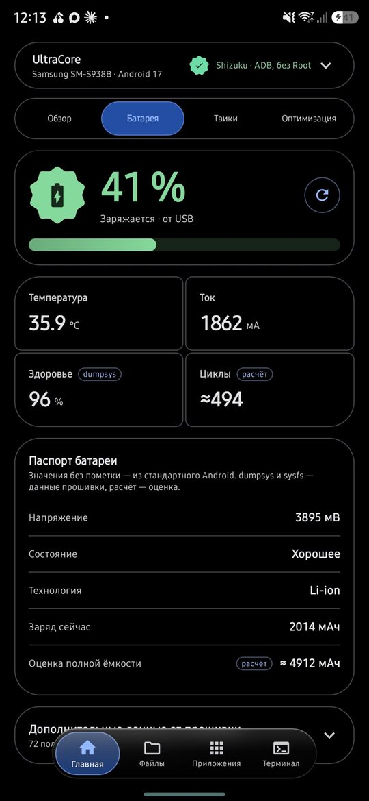
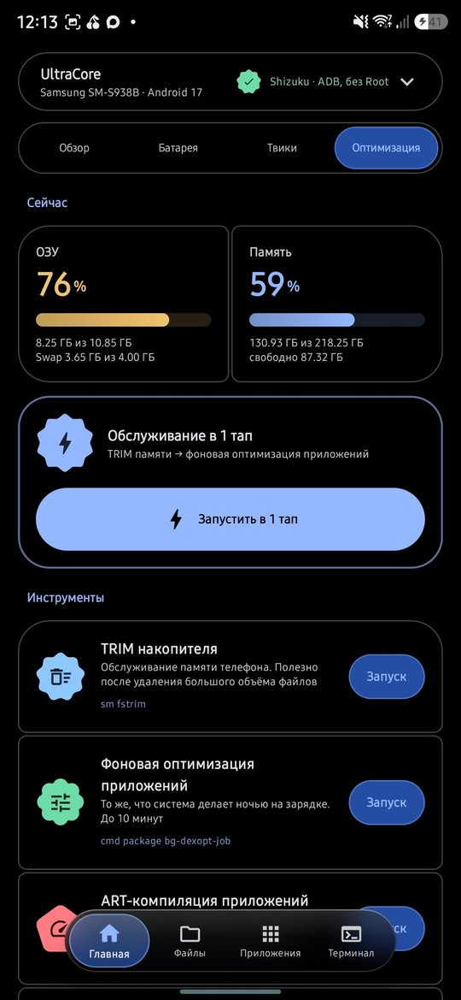
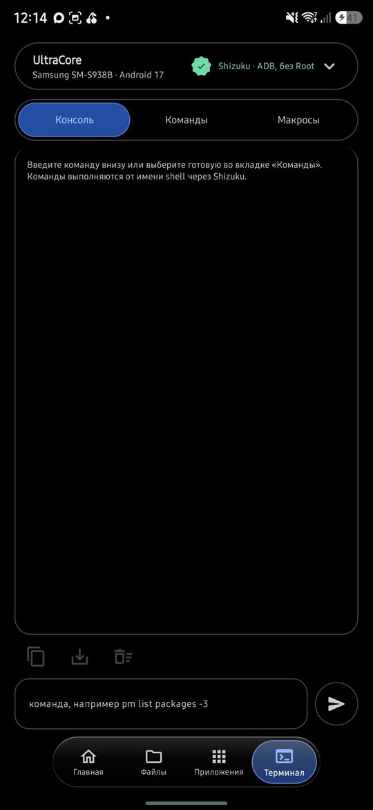

# UltraCore

  
   
  ▶ <a href="https://bolot4329-source.github.io/optiui9/promo/">Живая версия ролика</a> (16:9 и 9:16) · <a href="docs/promo/ultracore-promo.mp4">MP4</a>

Системный набор инструментов для **любого Android-смартфона** (Android 15, 16, 17 и новее; запускается и на 12–14). Работает через [Shizuku](https://shizuku.rikka.app/), **без Root**. Кода под конкретные марки нет: приложение само проверяет, что разрешено на вашем телефоне, и честно показывает ✅ работает / ⚠️ частично / 🔒 недоступно.

  
  
  

**📖 [Руководство пользователя](docs/TUTORIAL.md)** — что умеет каждая функция и как ей пользоваться, с нуля.

## Возможности

- **Главная**
  - **Обзор** — что работает на этом телефоне, проверяется безопасно, ничего не меняя.
  - **Батарея** — заряд, температура, ток, здоровье, число циклов, оценка ёмкости. У каждого значения подписан источник: Android, данные прошивки или расчёт.
  - **Твики** — скорость анимаций, закрепление частоты экрана, ограничение фоновых процессов, частный DNS (например, AdGuard блокирует рекламу во всех приложениях). У каждого твика есть «Сбросить».
  - **Оптимизация** — TRIM памяти, фоновая оптимизация приложений, ART-компиляция, сброс кэша.
  - **«Вернуть телефон как было»** — отменяет всё, что изменил UltraCore.
- **Файлы** — очистка мусора (остатки удалённых приложений, логи, пустые папки, дубликаты) с предпросмотром и сортировка файлов по правилам с откатом.
- **Приложения**
  - Запуск скрытых экранов и ярлыки на рабочий стол.
  - Пауза, заморозка и ограничение фоновой работы.
  - Удаление системных приложений для пользователя с восстановлением. Важные части системы защищены.
  - Бэкап и установка APK, APKS и XAPK.
  - Песочница: приложение размораживается при открытии и само замораживается после выключения экрана.
  - Экспорт и импорт списка изменений.
- **Терминал** — консоль с живым выводом и кнопкой «Стоп», каталог из 34 команд с описаниями, макросы и плитка в шторке.

## Установка

1. Скачайте `UltraCore-<версия>.apk` в разделе **[Releases](../../releases/latest)** и установите.
2. Установите и запустите **Shizuku** через «Беспроводную отладку» ([инструкция](https://shizuku.rikka.app/guide/setup/)). После каждой перезагрузки телефона Shizuku нужно запускать заново.
3. Откройте UltraCore, нажмите в шапке **«Разрешить»** и подтвердите в окне Shizuku.
4. Для очистки и сортировки файлов выдайте **«Доступ к файлам»**.

Если какой-то пункт отмечен 🔒 с подсказкой про ограничения отладки, поищите в «Для разработчиков» дополнительные переключатели. У некоторых производителей есть, например, «Отладка по USB (настройки безопасности)». Ещё проверьте в настройках безопасности функции, которые блокируют команды ADB.

## Безопасность

- Приложение использует только стандартные команды Android: `pm`, `am`, `settings`, `cmd`, `dumpsys`. Root не нужен, системные разделы не меняются.
- Каждый твик запоминает исходное значение. Каждая заморозка, пауза или удаление записывается и отменяется кнопкой «Вернуть всё».
- Файлы удаляются только после предпросмотра и подтверждения. Системные папки защищены.
- Перед удалением UltraCore нажмите «Вернуть телефон как было»: сами изменения после удаления приложения не исчезнут.

Пользуйтесь на свой страх и риск: замораживайте и удаляйте системные приложения, только если знаете, за что они отвечают.

## Сборка из исходников

APK собирается в GitHub Actions (`.github/workflows/build.yml`). Используются Gradle 8.10.2, AGP 8.7.3 и Kotlin 2.0.21. Релизы подписываются ключом из секретов репозитория. Без секретов (например, в форке) release-сборка подписывается отладочным ключом из репозитория, а такие APK **не совместимы** с официальными релизами.

Технические подробности — в `docs/TZ.md` и `CLAUDE.md`.

## Лицензия

[GPL-3.0](LICENSE): код можно использовать и менять, но изменённые версии тоже должны оставаться открытыми.

Подлинные релизы подписаны ключом с отпечатком SHA-256:
`22:A9:15:62:B3:29:35:70:66:EA:6B:BF:09:B0:E6:03:AD:41:45:D1:BC:B0:35:4B:5A:20:84:63:DF:D9:2A:D7`

